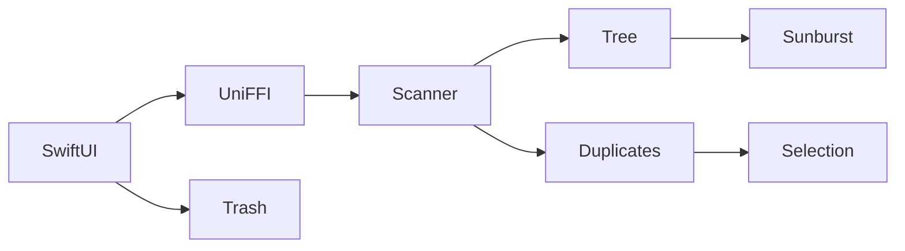

# DiskLens

DiskLens is a macOS app that shows where disk space went and helps delete copies safely. The walk, the size tree, duplicate hashing, and the "which copy do I keep" rules are a Rust library. The window is SwiftUI. They talk through [UniFFI](https://mozilla.github.io/uniffi-rs/).

It is aimed at the same job as DaisyDisk, GrandPerspective, and a careful duplicate finder: a map you can click into, a list beside it, categories, large and old files, and a review step before anything is removed. Removal goes to the Trash unless you explicitly confirm a permanent delete.



A longer version of that picture, and the reason each size number exists, is in [docs/ARCHITECTURE.md](docs/ARCHITECTURE.md).

## What you can do

- See every mounted volume with used and free space, then scan one.
- Open any folder.
- Switch between a sunburst and a treemap, click a slice to go inside, and use the breadcrumb or Command-Up to come back.
- Read categories (photos, video, archives, developer caches, apps, system files).
- Filter large and old files.
- Find duplicates. Files are grouped by size, then by a hash of the first and last blocks, then by a full BLAKE3 hash. Hard links of one file are not reported as copies.
- Apply a keep rule: newest, oldest, a preferred folder, the shortest path, or the name that does not look like a copy. System folders, Library, app bundles, and Photos libraries are never auto-selected.
- Review the reclaim estimate, then move the selection to the Trash. Permanent delete requires typing `DELETE`. History can put Trash items back.

## Repository

| Path | What it is |
| --- | --- |
| `core/diskscan` | Rust library. |
| `core/diskscan-cli` | Terminal frontend, useful on Linux and macOS. |
| `apple/DiskLens` | SwiftUI app. |
| `apple/Generated` | Swift bindings generated by UniFFI. Regenerated by the build script. |
| `apple/project.yml` | XcodeGen project. |
| `scripts/build-rust.sh` | Builds the library and, on a Mac, the XCFramework. |
| `docs/ARCHITECTURE.md` | How the pieces fit. |
| `docs/SANDBOX.md` | Why the app is not sandboxed, and how Full Disk Access works. |
| `AGENTS.md` | Notes for the next person or agent changing the code. |

## Try the engine without Xcode

You need a stable Rust toolchain (1.83 or newer; CI uses current stable).

```bash
make test
make clippy
cargo run --manifest-path core/Cargo.toml -p diskscan-cli -- scan ~/Documents --depth 2
cargo run --manifest-path core/Cargo.toml -p diskscan-cli -- dupes ~/Documents
cargo run --manifest-path core/Cargo.toml -p diskscan-cli -- usage ~
```

`make test` is `cargo test` for the workspace. The suite builds temp directories and covers nested sizes, hard links, symlink cycles, unreadable folders, cancellation, partial-versus-full hashing, smart selection, and deletion plans.

## Build and run the Mac app

The Swift app was written against the generated UniFFI bindings. It has **not** been compiled in this environment: the authoring machine is Linux and has no Xcode. Build it on a Mac with Xcode 15 or newer (the app targets macOS 14).

1. Install the tools if you do not have them.

   ```bash
   xcode-select --install
   brew install xcodegen
   curl --proto '=https' --tlsv1.2 -sSf https://sh.rustup.rs | sh
   ```

2. From the repository root, build the universal static library and refresh the Swift bindings. This compiles for Apple silicon and Intel and creates `apple/Vendor/DiskScanFFI.xcframework`.

   ```bash
   ./scripts/build-rust.sh
   ```

3. Generate the Xcode project and open it.

   ```bash
   ./scripts/generate-xcode.sh
   open apple/DiskLens.xcodeproj
   ```

4. In Xcode, select the DiskLens scheme and run. The first window explains Full Disk Access. You can scan a folder you pick without that permission. Grant Full Disk Access (System Settings → Privacy & Security → Full Disk Access, add DiskLens, quit and reopen) when you want protected folders included.

5. To build and run the tests from the terminal:

   ```bash
   xcodebuild -project apple/DiskLens.xcodeproj -scheme DiskLens -destination 'platform=macOS' build test
   ```

Signing uses Automatic signing and your Apple ID team. The app is not sandboxed; see [docs/SANDBOX.md](docs/SANDBOX.md) before you ship it.

### If the Rust static library fails to link

The Swift file calls the C functions in `diskscanFFI`, so the linker should pull those symbols out of the static XCFramework. If a clean build reports undefined UniFFI symbols, add this to the DiskLens target's Other Linker Flags in `apple/project.yml` and regenerate:

```text
-force_load $(PROJECT_DIR)/Vendor/DiskScanFFI.xcframework/macos-arm64/libdiskscan.a
```

Use the slice that matches the Mac you are building on (`macos-arm64` or `macos-x86_64`). Only do this if the link actually fails.

## Design choices

- **macOS 14** rather than 13, so view models can use `@Observable` instead of `ObservableObject`.
- **Decimal byte sizes**, matching Finder (1 KB = 1,000 bytes).
- **Unique size as the default chart metric.** Logical size is available when you want every hard link counted again. Allocated size is closer to `du`.
- **Clone detection is on by default** and can be turned off in Settings. It costs one `getattrlist` per file on APFS and does nothing on Linux.
- **Empty files are not duplicates** unless the minimum size is 0.
- **Developer caches** include `node_modules`, `DerivedData`, Cargo `target`, and similar directory names. A folder you happened to name `target` will be labelled as a cache. The category is a hint, not a delete button.

## Status of verification

| Piece | Where it was checked |
| --- | --- |
| Rust scanner, categories, layout, duplicates, selection, deletion plans | `cargo test` and `cargo clippy --all-targets -- -D warnings` on Linux |
| UniFFI Swift bindings | Generated on Linux from the host library with UniFFI 0.32 |
| SwiftUI app, Xcode project, XCFramework, Quick Look, Trash | Not compiled here. Needs the steps above on a Mac. |

Continuous integration (`.github/workflows/ci.yml`) runs the Rust suite on Linux and, on a macOS 14 runner, the Rust script plus `xcodebuild` build and test.
