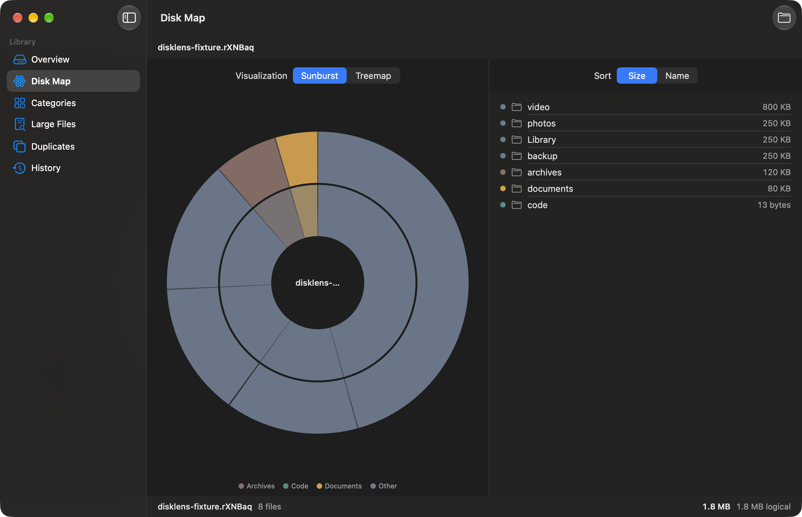
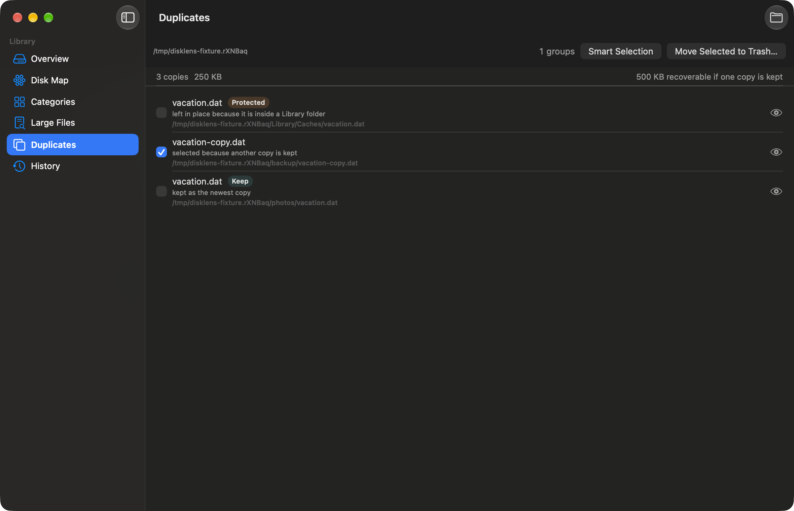
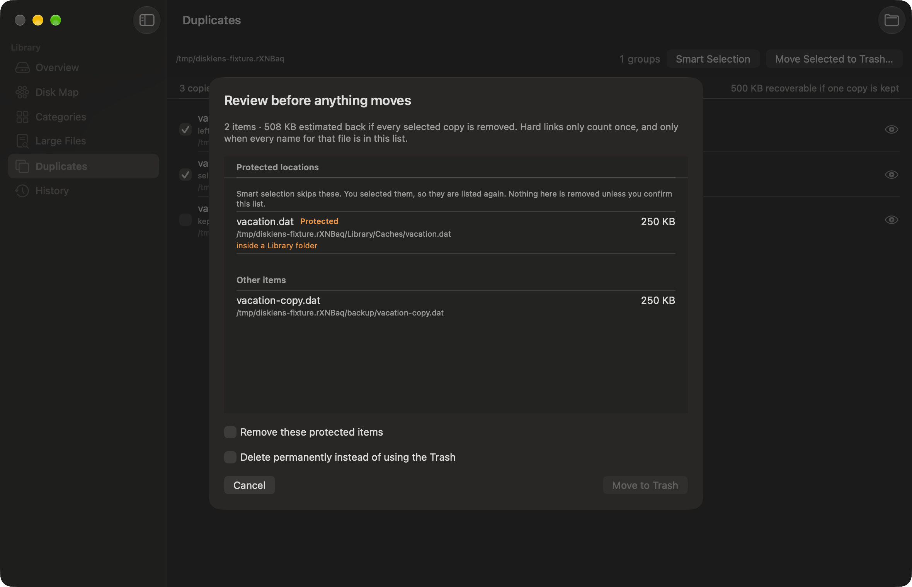

<h1 align="center">DiskLens</h1>

<p align="center">
  A disk map for the Mac. See where the space went, then delete copies only after a review.
</p>

<p align="center">
  <em>There are many disk maps. This one asks twice before it deletes.</em>
</p>

<p align="center">
  <a href="https://github.com/sitasp/disklens/releases/tag/v0.1.0-alpha.1"></a>
</p>

<p align="center">
  
  
  
  
  
</p>

<p align="center">
  
</p>

<p align="center">
  
</p>

<p align="center">
  
</p>

---

DiskLens draws a sunburst or a treemap of a folder, then finds copies. Nothing moves until the review screen. Protected places, including Library and app bundles, stay unselected until you confirm them a second time. The walk, the hashes, and the keep rules are Rust. The window is SwiftUI.

**Map** — Open a folder, or scan a volume from Overview. Click a slice to go inside. Switch to a treemap. Sizes default to unique bytes, so a hard link or an APFS clone is not counted twice.

**Duplicates** — Files are grouped by size, then by the ends of the file, then by a full BLAKE3 hash. Hard links of one file are not reported as copies. Smart selection keeps one and marks the rest, and it will not mark System, Library, or an app bundle.

**Review** — Trash is the default. A protected path you selected yourself is listed again, and Move to Trash stays off until you confirm that list. Permanent delete requires the word `DELETE`. History can put Trash items back.

This download is **0.1.0 alpha**, an ad-hoc signed Apple silicon build. It is not notarized. The first open is Control-click, then Open. Details are in the [release notes](https://github.com/sitasp/disklens/releases/tag/v0.1.0-alpha.1). How the numbers move is in [docs/features/release-versioning.md](docs/features/release-versioning.md).

## Repository

| Path | What it is |
| --- | --- |
| `core/diskscan` | Rust library. |
| `core/diskscan-cli` | Terminal frontend, useful on Linux and macOS. |
| `apple/DiskLens` | SwiftUI app. |
| `apple/Generated` | Swift bindings generated by UniFFI. Regenerated by the build script. |
| `apple/project.yml` | XcodeGen project. |
| `scripts/build-rust.sh` | Builds the library and, on a Mac, the XCFramework. |
| `docs/ARCHITECTURE.md` | How the pieces fit. |
| `docs/SANDBOX.md` | Why the app is not sandboxed, and how Full Disk Access works. |
| `docs/features/` | Implementation notes for the Mac build, clone identity, tests, and the chart fixes. |
| `AGENTS.md` | Notes for the next person or agent changing the code. |

## Try the engine without Xcode

You need a stable Rust toolchain (1.83 or newer; CI uses current stable).

```bash
make test
make clippy
cargo run --manifest-path core/Cargo.toml -p diskscan-cli -- scan ~/Documents --depth 2
cargo run --manifest-path core/Cargo.toml -p diskscan-cli -- dupes ~/Documents
cargo run --manifest-path core/Cargo.toml -p diskscan-cli -- usage ~
```

`make test` is `cargo test` for the workspace. The suite builds temp directories and covers nested sizes, hard links, symlink cycles, unreadable folders, cancellation, partial-versus-full hashing, smart selection, and deletion plans.

## Build and run the Mac app

The app targets macOS 14 and builds with Xcode 15 or newer. It was verified on macOS 27 with Xcode 27.2 and Rust 1.100.

1. Install the tools if you do not have them.

   ```bash
   xcode-select --install
   curl --proto '=https' --tlsv1.2 -sSf https://sh.rustup.rs | sh
   source "$HOME/.cargo/env"
   ```

   XcodeGen generates the project. `brew install xcodegen` works when the Command Line Tools are current enough for Homebrew. If Homebrew refuses to install packages because the Command Line Tools are older than the OS, put the XcodeGen binary on `PATH` yourself (this Mac uses `~/.local/bin/xcodegen`, version 2.48). `scripts/generate-xcode.sh` resolves that symlink so XcodeGen can find its setting presets. Without the presets the generated app has an empty product name.

2. From the repository root, build the universal static library and refresh the Swift bindings. This compiles for Apple silicon and Intel, combines them with `lipo` into one macOS library (current Xcode rejects an XCFramework that lists the two architectures separately), sets the deployment target to 14.0, and creates `apple/Vendor/DiskScanFFI.xcframework`.

   ```bash
   source "$HOME/.cargo/env"
   ./scripts/build-rust.sh
   ```

3. Generate the Xcode project and open it.

   ```bash
   ./scripts/generate-xcode.sh
   open apple/DiskLens.xcodeproj
   ```

4. In Xcode, run the **DiskLens** scheme for the direct, unsandboxed app. The first window explains Full Disk Access. You can scan a folder you pick without that permission. Grant Full Disk Access (System Settings → Privacy & Security → Full Disk Access, add DiskLens, quit and reopen) when you want protected folders included.

   A directory passed on the command line is scanned immediately. The built app from `xcodebuild` lives under DerivedData (`~/Library/Developer/Xcode/DerivedData/DiskLens-*/Build/Products/Debug/DiskLens.app`):

   ```bash
   open /path/to/DiskLens.app --args /path/to/folder
   ```

   Run the **DiskLensStore** scheme for the sandboxed App Store build. It only reads folders you pick, saves a security-scoped bookmark for each one, and confirms that access again before a deletion. The product on disk is `DiskLensStore.app` so it does not overwrite the direct app. The bundle id is still `com.disklens.DiskLens`. See [docs/SANDBOX.md](docs/SANDBOX.md).

5. To build and run the tests from the terminal:

   ```bash
   xcodebuild -project apple/DiskLens.xcodeproj -scheme DiskLens -destination 'platform=macOS' build test
   xcodebuild -project apple/DiskLens.xcodeproj -scheme DiskLensStore -destination 'platform=macOS' build test
   ```

Signing is ad hoc ("Sign to Run Locally"). No Apple Developer Program membership is required to build, test, or launch on the same Mac. Notarization and the App Store need that membership, which Apple calls a development team. It is separate from the people working on DiskLens. This Mac has no Apple code-signing certificate, so the project stays ad hoc. See [docs/features/adhoc-signing.md](docs/features/adhoc-signing.md). The direct app is not sandboxed; see [docs/SANDBOX.md](docs/SANDBOX.md) before you ship it.

### If the Rust static library fails to link

The Swift file calls the C functions in `diskscanFFI`, so the linker should pull those symbols out of the static XCFramework. If a clean build reports undefined UniFFI symbols, add this to the DiskLens target's Other Linker Flags in `apple/project.yml` and regenerate:

```text
-force_load $(PROJECT_DIR)/Vendor/DiskScanFFI.xcframework/macos-arm64_x86_64/libdiskscan.a
```

Only do this if the link actually fails. The slice name is `macos-arm64_x86_64` because both architectures live in one library.

## Design choices

- **macOS 14** rather than 13, so view models can use `@Observable` instead of `ObservableObject`.
- **Decimal byte sizes**, matching Finder (1 KB = 1,000 bytes).
- **Unique size as the default chart metric.** Logical size is available when you want every hard link counted again. Allocated size is closer to `du`.
- **Clone detection is on by default** and can be turned off in Settings. It costs one `getattrlist` per file on APFS and does nothing on Linux.
- **Empty files are not duplicates** unless the minimum size is 0.
- **Developer caches** include `node_modules`, `DerivedData`, Cargo `target`, and similar directory names. A folder you happened to name `target` will be labelled as a cache. The category is a hint, not a delete button.

## Status of verification

| Piece | Where it was checked |
| --- | --- |
| Rust scanner, categories, layout, duplicates, selection, deletion plans | `cargo test` and `cargo clippy --all-targets -- -D warnings` on Linux, and again on macOS 27 (Apple silicon) |
| UniFFI Swift bindings | UniFFI 0.32. The committed Swift matches the library built on this Mac |
| SwiftUI app, both schemes, XCFramework | `xcodebuild` build and test for DiskLens and DiskLensStore on macOS 27 with Xcode 27.2, ad-hoc signed |

Continuous integration (`.github/workflows/ci.yml`) runs the Rust suite on Linux and, on a macOS 14 runner, the Rust script plus `xcodebuild` build and test.

## Releases

Versions are `vMAJOR.MINOR.PATCH` tags. Alphas and betas add `-alpha.N` or `-beta.N` and are GitHub prereleases. The app itself shows three numbers plus the channel, so this first public build is **0.1.0 alpha**. The scheme is in [docs/features/release-versioning.md](docs/features/release-versioning.md). Downloads are on the [GitHub mirror](https://github.com/sitasp/disklens/releases).

## Support

If DiskLens saves you a cleanup afternoon:

[](https://ko-fi.com/sitasp)
[](https://www.buymeacoffee.com/sitasp)
