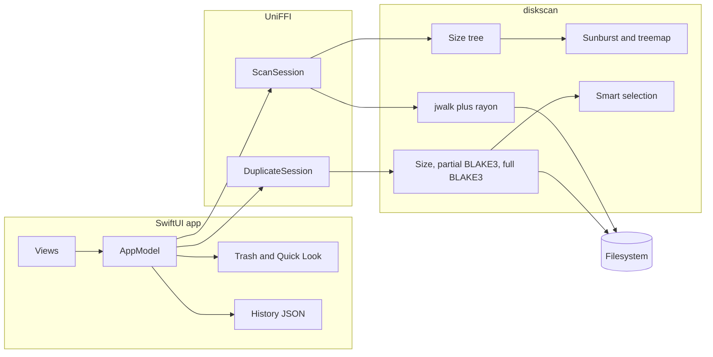

# Architecture

DiskLens is a macOS disk map and cleanup app. The part that walks the disk, hashes files, and decides what is safe to select lives in Rust. The part that draws windows, talks to the Trash, and shows Quick Look lives in SwiftUI. They meet at a C ABI generated by [UniFFI](https://mozilla.github.io/uniffi-rs/).

## Why the split looks like this

Walking a home directory is dominated by `readdir` and `stat`. Doing that on a pool, and hashing candidates in parallel, is the kind of work Rust is good at and that is easy to test on Linux. Drawing a sunburst, opening a folder panel, and moving a file to the Trash are AppKit operations. UniFFI keeps the boundary narrow: Swift asks for a summary, a page of children, or a layout, and the tree stays in the Rust object.

macOS 14 is the deployment target. That is the first release with the `@Observable` macro, which is how the view models publish state, and it is where `NavigationSplitView` is settled enough to build a sidebar app on. macOS 13 would have forced `ObservableObject` and a different settings scene. The owner can lower the target later if they still need Ventura; the Rust library does not care.

## Crates

| Path | Role |
| --- | --- |
| `core/diskscan` | Library. Also builds a staticlib and cdylib, and the `uniffi-bindgen` binary. |
| `core/diskscan-cli` | `diskscan scan`, `diskscan dupes`, `diskscan usage` for trying the engine without Xcode. |

The library is Unix-only. Linux CI is the filesystem test bed. macOS adds APFS clone ids.

## Scan

`scan` in `core/diskscan/src/scan.rs`:

1. Normalizes the root lexically. It does not resolve the final symlink, so the path the user picked is the path they see.
2. Walks with `jwalk` on a private rayon pool. Hidden files are included unless asked otherwise. Symlinks are leaves unless follow is on. `jwalk` reports symlink cycles as errors instead of looping.
3. If `stay_on_filesystem` is set, directories whose device id differs from the root are not descended into. Use that for a volume. Leave it off for a folder that is allowed to span mounts.
4. Cancellation is checked between entries on the consuming thread. In-flight `readdir` calls finish, then the function returns `ScanError::Cancelled` and no tree.
5. The flat entries become a tree. Children are visited in file-name order so the first path to own a shared inode is stable, then each directory's children are sorted by unique apparent size for the UI.

Progress callbacks run on the consuming thread, about every 64 entries. They must be fast. The Swift `ProgressRelay` hops to the main actor before touching a view model.

### Sizes

Three numbers are stored on every node:

- **Logical apparent** sums file lengths once per path. Two hard links add up to twice the length.
- **Unique apparent** counts that length once per identity.
- **Unique allocated** is `st_blocks * 512`, with the same sharing rule, plus each directory's own allocated blocks.

An identity is the device plus inode, unless macOS returns a non-zero APFS clone id (`getattrlist` with `ATTR_CMNEXT_CLONEID` and `FSOPT_ATTR_CMN_EXTENDED`, constants from xnu `bsd/sys/attr.h`). Clones then share one unique size. The call is a no-op on Linux. It is optional because it is an extra syscall per file.

Symbolic links do not add their target's size. Unreadable directories stay in the tree with `error` set and are also listed in `ScanTree::issues`. They do not fail the scan.

The volume banner uses `statvfs`, not the sum of the tree. Snapshots, purgeable space, and files the scan could not see are why those two numbers differ. The UI says so.

## Categories and queries

`categorize` looks at path components before the extension. `node_modules`, `DerivedData`, Cargo `target`, and the other names in `category.rs` are developer caches even when the file extension is source. Anything inside a `.app` bundle is an application. `/System`, `/usr`, `/bin`, `/sbin`, and `/Library` are system. A component named `Library` under a home directory is not automatically "system"; protection of `~/Library` is a separate rule used only by duplicate selection.

`query_files` and `summarize_categories` walk the finished tree in memory.

## Layout

`sunburst` and `treemap` are pure functions of a node. Angles are radians, 0 at the east, increasing counter-clockwise, with the first slice at 12 o'clock (`-π/2`). The treemap is the squarified algorithm: areas match sizes, rectangles stay inside the box. Swift only draws the records. Resizing the window asks Rust for a new treemap; it does not rescan.

## Duplicates

`find_duplicates`:

1. Reuses the scanner so symlink and hidden-file policy match the map.
2. Drops files smaller than `min_size` (default 1 byte, so empty files are not one giant group).
3. Groups by size. A group whose paths are all one inode or one clone id is discarded. Hard links are not copies.
4. For files larger than the partial window, hashes the first and last window with BLAKE3 (domain-separated) and drops groups that differ.
5. Hashes the survivors in full, again with a different domain string, and keeps groups that still match.

Unreadable files are skipped and listed. They do not fail the search.

`wasted_bytes` is the estimate if one identity is kept. `reclaimable_bytes` is the estimate for a specific selection: an identity contributes its size only when every selected path of that inode covers `nlink`, so a leftover link outside the group does not pretend to free space.

## Smart selection

`select_group` picks one keeper, then marks every other file for removal unless it is protected. Protected files are never selected, even when they lose the comparison. If every copy is protected, nothing is selected.

Keep rules: newest, oldest, a preferred directory (then shortest path), shortest path, or the name that does not look like "Copy of", "copy", or "(1)". Missing timestamps lose to real ones in both the newest and oldest rules.

Default protected locations:

- Prefixes: `/System`, `/usr`, `/bin`, `/sbin`, `/Library`, `/private/var`, `/dev`. Matching is on a path boundary, so `/usr` does not protect `/usr-local`.
- Any component named `Library` (this includes `~/Library`).
- Packages: `.app`, `.photoslibrary`, `.photolibrary`, `.framework`, `.bundle`, `.kext`, `.plugin`, `.prefPane`.
- Extra prefixes from Settings.

The user can still select a protected file by hand. The review screen is the second confirmation. Automatic selection will not do it.

## Deletion

`plan_deletion` does not delete. It stats each path, skips protected paths unless `allow_protected` is set, refuses to follow symlinks (removing a link must not be reported as removing the target), and expands directories with another scan. The plan's `reclaimable_bytes` uses the same hard-link rule as duplicates.

`plan_deletion(..., include_protected: false)` records protected paths as skipped. The app calls it with `include_protected: true` after a manual selection, so those paths stay in the plan with `protected` and `protection_reason` set. The review lists them in their own section and will not proceed until that list is confirmed.

The Swift app then either:

- moves the approved paths to the Trash with `FileManager.trashItem`, recording the original path and the Trash URL, or
- after the user types `DELETE`, calls `removeItem`.

History is a JSON file in Application Support. Put Back moves a trashed URL to the original path, or beside it if that path is occupied. Permanent deletions are recorded but cannot be restored.

## FFI

`core/diskscan/src/ffi.rs` is the only module that knows about UniFFI. It exposes:

- `CancelFlag`
- `ProgressSink`, implemented in Swift
- `scan_folder` → `ScanSession` (summaries, children, categories, large files, sunburst, treemap, issues)
- `find_duplicate_files` → `DuplicateSession`
- `volume_usage`, `format_byte_count`, `review_deletion`
- default option constructors

`ScanSession` keeps the tree. Swift does not receive every node up front.

`scripts/build-rust.sh` builds `aarch64-apple-darwin` and `x86_64-apple-darwin` static libraries on a Mac, generates the Swift file, and packs `apple/Vendor/DiskScanFFI.xcframework`. On Linux it regenerates `apple/Generated/diskscan.swift` from the host `.so` and stops. The generated Swift is committed so the project can be read without a rebuild; the script overwrites it.

## App

`apple/project.yml` is an XcodeGen spec with two application targets. `DiskLens` is unsandboxed for direct distribution. `DiskLensStore` is sandboxed, compiled with `DISKLENS_SANDBOX`, and uses security-scoped bookmarks for every scan and deletion. Both are macOS 14, Swift 5, hardened runtime on. Views call `AppModel`. `AppModel` calls UniFFI on a detached task and publishes summaries. Settings live in `UserDefaults`. The first launch explains Full Disk Access, or folder bookmarks, depending on the target.

See `docs/SANDBOX.md` for the entitlement choice.
